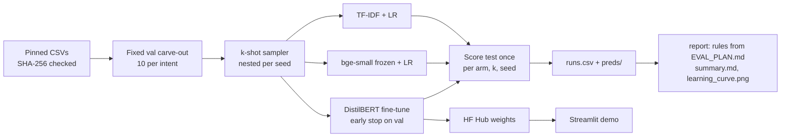

# Fine-tune or not? A learning curve on BANKING77

> At how many labelled examples per intent does a fine-tuned DistilBERT beat TF-IDF and frozen-embedding baselines? A paired, pre-registered learning curve on BANKING77.

[](https://github.com/Prithv122/finetune-transformer/actions/workflows/ci.yml)

**Status:** pipeline built and tested; **no test-split result yet.** The 45-run sweep runs on a Kaggle GPU and every number
below will come from its `results/runs.csv`.
**Live demo:** not deployed yet (Streamlit Community Cloud, after the weights are on the Hugging Face Hub).
**Stack:** Python 3.12 · scikit-learn · sentence-transformers · PyTorch + transformers (plain training loop) · Streamlit

---

## 1. The problem

A support team that wants to route customer messages into intents has three cheap options before it calls an LLM:
a bag-of-words model, a frozen sentence encoder with a linear head, or fine-tuning a small transformer. Fine-tuning
costs a GPU, a training loop and a model to host, so the useful question is not "is it better" but **how many labelled
examples per intent it takes before it is better**, and by how much once all the labels are in.

## 2. The data

| | |
|---|---|
| Source | [BANKING77](https://github.com/PolyAI-LDN/task-specific-datasets) (Casanueva et al. 2020), upstream CSVs pinned to commit `57ec275`, SHA-256 checked |
| Size | 13,083 banking queries, 77 intents; official split 10,003 train / 3,080 test (40 per intent) |
| Licence | CC-BY-4.0 |
| Validation | 770 rows (10 per intent) carved from train once and shared by every run; the other 9,233 rows are the pool |
| Refresh | one-off |

The 770 validation labels are extra labels a true k-shot user would not have; every arm uses them for exactly one choice
(the regularisation strength for the baselines, the stopping epoch for fine-tuning). `src/finetune/fixtures/mini_intents.csv`
is 60 real train rows (6 intents) used only by the tests.

## 3. Architecture



Grid: 3 arms x k in {5, 10, 25, 50, all} x seeds {1, 2, 3} = 45 runs. For a given (k, seed) all three arms train on the
same rows, and a seed's draws are nested (its k = 5 rows are the first 5 of its k = 10 rows), so moving right on the curve
only ever adds data.

## 4. Key decisions & tradeoffs

| Decision | Chose | Over | Why |
|---|---|---|---|
| When the protocol is fixed | `EVAL_PLAN.md` committed before any test score | deciding the rules after seeing the curve | A crossover point is easy to "find" after the fact; the rule (mean ahead **and** seed ranges apart) is written down first |
| Training loop | plain PyTorch (AdamW, linear warmup, early stop) | HF `Trainer` | ~100 lines I can explain line by line and test on a tiny CPU model in CI |
| Comparison design | same rows for every arm per (k, seed), nested across k | independent draws per arm | Paired: differences between arms are not sampling noise in which examples were drawn |
| Fairness of tuning | one choice per arm on the same val set | grid search for fine-tuning only | Giving only the neural arm a tuning budget would bias the answer toward fine-tuning |
| Data source | upstream CSVs pinned by commit and digest | the Hub dataset | The Hub entry is a loading script that current `datasets` refuses to run; pinned bytes cannot change under a result |
| Demo host | Streamlit Community Cloud, weights from the Hub | HF Spaces, Cloud Run | No billing account needed; DistilBERT fits the free RAM limit |

## 5. Results

_Pending the Kaggle sweep. This section will hold the macro-F1 learning curve (mean and seed range per arm), the crossover
k, the full-data gap with its paired bootstrap interval, calibration (ECE), the 10 hardest intents, and CPU latency per
query, all generated by `finetune report` from the committed `results/` files._

## 6. How to run

```bash
git clone https://github.com/Prithv122/finetune-transformer.git
cd finetune-transformer
uv sync --all-groups
uv run pytest -m "not slow"          # fast tests, no torch
uv run finetune data-download        # pinned CSVs into data/raw/banking77/
uv run finetune data-check           # split and k-shot sizes
```

Baselines only, on CPU (minutes):

```bash
uv sync --all-groups --extra embed
uv run finetune sweep --arms tfidf,embed
uv run finetune report
```

The full sweep including fine-tuning needs a GPU: open `notebooks/train_kaggle.ipynb` on Kaggle (GPU T4, internet on),
set `REF` to the commit to run, and run all cells. The sweep is resumable, so a re-run after a disconnect continues
where it stopped. Classify text with a checkpoint:

```bash
uv sync --all-groups --extra train
uv run finetune predict --model models/finetune_kall_s1 "my card still hasn't arrived"
```

Slow tests (tiny real models, CPU torch): `uv run pytest -m slow`.

## 7. What I'd change at 100x scale

_To be written with the results._

---

## References

- Casanueva, Temčinas, Gerz, Henderson, Vulić (2020). *Efficient Intent Detection with Dual Sentence Encoders.* arXiv:2003.04807 (BANKING77).
- Sanh et al. (2019). *DistilBERT, a distilled version of BERT.* arXiv:1910.01108.
- `BAAI/bge-small-en-v1.5` model card (frozen encoder for the embedding arm).
