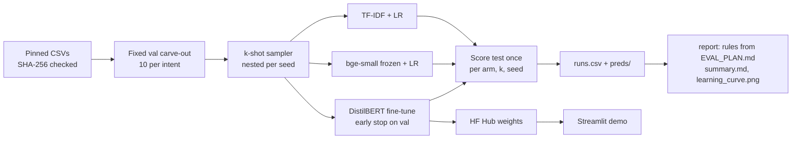

# Fine-tune or not? A learning curve on BANKING77

> At how many labelled examples per intent does a fine-tuned DistilBERT beat TF-IDF and frozen-embedding baselines? A paired, pre-registered learning curve on BANKING77.

[](https://github.com/Prithv122/finetune-transformer/actions/workflows/ci.yml)

**Result:** **fine-tuning never paid off here.** Frozen `bge-small` embeddings with a logistic-regression head beat a fully
fine-tuned DistilBERT at every training-set size, from 5 labels per intent up to the whole training pool (about 120 per intent), and the gap at full data
(1.1 to 1.8 macro-F1 points) has a paired bootstrap interval that excludes zero for all three seeds. 45 runs, one commit,
rules fixed before the test split was scored.
**Live demo:** not deployed yet (Streamlit Community Cloud, after the weights are on the Hugging Face Hub).
**Stack:** Python 3.12 · scikit-learn · sentence-transformers · PyTorch + transformers (plain training loop) · Streamlit

---

## 1. The problem

A support team that wants to route customer messages into intents has three cheap options before it calls an LLM:
a bag-of-words model, a frozen sentence encoder with a linear head, or fine-tuning a small transformer. Fine-tuning
costs a GPU, a training loop and a model to host, so the useful question is not "is it better" but **how many labelled
examples per intent it takes before it is better**, and by how much once all the labels are in.

## 2. The data

| | |
|---|---|
| Source | [BANKING77](https://github.com/PolyAI-LDN/task-specific-datasets) (Casanueva et al. 2020), upstream CSVs pinned to commit `57ec275`, SHA-256 checked |
| Size | 13,083 banking queries, 77 intents; official split 10,003 train / 3,080 test (40 per intent) |
| Licence | CC-BY-4.0 |
| Validation | 770 rows (10 per intent) carved from train once and shared by every run; the other 9,233 rows are the pool |
| Refresh | one-off |

The 770 validation labels are extra labels a true k-shot user would not have; every arm uses them for exactly one choice
(the regularisation strength for the baselines, the stopping epoch for fine-tuning). `src/finetune/fixtures/mini_intents.csv`
is 60 real train rows (6 intents) used only by the tests.

## 3. Architecture



Grid: 3 arms x k in {5, 10, 25, 50, all} x seeds {1, 2, 3} = 45 runs. For a given (k, seed) all three arms train on the
same rows, and a seed's draws are nested (its k = 5 rows are the first 5 of its k = 10 rows), so moving right on the curve
only ever adds data.

## 4. Key decisions & tradeoffs

| Decision | Chose | Over | Why |
|---|---|---|---|
| When the protocol is fixed | `EVAL_PLAN.md` committed before any test score | deciding the rules after seeing the curve | A crossover point is easy to "find" after the fact; the rule (mean ahead **and** seed ranges apart) is written down first |
| Training loop | plain PyTorch (AdamW, linear warmup, early stop) | HF `Trainer` | ~100 lines I can explain line by line and test on a tiny CPU model in CI |
| Comparison design | same rows for every arm per (k, seed), nested across k | independent draws per arm | Paired: differences between arms are not sampling noise in which examples were drawn |
| Fairness of tuning | one choice per arm on the same val set | grid search for fine-tuning only | Giving only the neural arm a tuning budget would bias the answer toward fine-tuning |
| Data source | upstream CSVs pinned by commit and digest | the Hub dataset | The Hub entry is a loading script that current `datasets` refuses to run; pinned bytes cannot change under a result |
| Demo host | Streamlit Community Cloud, weights from the Hub | HF Spaces, Cloud Run | No billing account needed; DistilBERT fits the free RAM limit |

## 5. Results

All 45 runs come from one sweep on a Kaggle T4 at commit `dd2e52a` (2026-10-25). Every number below is in
`results/summary.md`, which `finetune report` regenerates byte for byte from `results/runs.csv` and `results/preds/`.
Test split: BANKING77's official 3,080 queries, scored once per run.


**Macro-F1 on test, mean over 3 seeds [min, max]**

| labels per intent | 5 | 10 | 25 | 50 | all (9,233 rows) |
|---|---|---|---|---|---|
| TF-IDF + LR | 0.548 [0.527, 0.564] | 0.676 [0.663, 0.695] | 0.793 [0.787, 0.800] | 0.851 [0.845, 0.856] | 0.891 |
| bge-small frozen + LR | **0.826** [0.820, 0.829] | **0.873** [0.870, 0.877] | **0.906** [0.905, 0.909] | **0.921** [0.918, 0.923] | **0.932** |
| DistilBERT fine-tuned | 0.678 [0.670, 0.683] | 0.802 [0.798, 0.807] | 0.872 [0.862, 0.879] | 0.904 [0.902, 0.905] | 0.918 [0.914, 0.921] |

**The three pre-registered answers** (`EVAL_PLAN.md`, decided by `finetune report`):

| Rule | Answer | The numbers behind it |
|---|---|---|
| 1. Crossover: smallest k where fine-tuning beats the better baseline on the mean **and** on seed ranges | **Not reached up to k = all** | The better baseline is the embedding arm at every k; fine-tuning trails it by 14.8, 7.2, 3.4, 1.7 and 1.4 points |
| 2. Headline: at k = all, fine-tuning beats TF-IDF by at least 5 points | **Did not pay off** | +2.7 points (0.918 vs 0.891) |
| 3. Null result: fine-tuning <= embeddings at every k | **Null result** | True at all five k |

**Is the full-data gap real?** Paired bootstrap over the 3,080 test rows (2,000 resamples), fine-tuned minus embedding
arm, same run seed: seed 1 **-1.1** points [-2.1, -0.2], seed 2 **-1.8** [-2.8, -0.9], seed 3 **-1.2** [-2.1, -0.4].
All three intervals exclude zero.

**What each arm costs.** Training time per run on the Kaggle machine, median over seeds, at k = all: TF-IDF 73 s (CPU),
embeddings 48 s (encoding on the GPU, then CPU LR), fine-tuning 236 s on the T4 (best epoch 4 to 6, early-stopped). The whole
sweep: 6.1 minutes for TF-IDF, 4.8 for embeddings, 31.6 GPU-minutes for fine-tuning.

**Calibration** (expected calibration error, 10 bins; lower is better). Fine-tuning is the best-calibrated arm from k = 10
on (0.031 to 0.061, and 0.036 at k = all); the embedding arm's raw probabilities are less calibrated at full data (0.110).
A post-hoc calibration step would narrow that, and it was not part of the plan.

**Where the errors are.** The hardest intents are the same family for both strong arms: transfers and balances
(`transfer_not_received_by_recipient`, `pending_transfer`, `transfer_timing`, `balance_not_updated_after_bank_transfer`),
queries that differ by one detail of timing or status rather than by topic.

**Latency: not reported yet.** The plan lists CPU latency per query as informative only. The one measurement so far
(`finetune latency`) ran while other jobs held this machine's CPU at 100%, which inflated every arm by an unknown factor,
so it is not quoted. Reproduce on an idle machine with
`uv run --extra train --extra embed finetune latency --model models/finetune_kall_s1`.

**Limitation: the baselines' C sat on the grid's edge.** The logistic-regression grid (amended to {0.1, 1, 10, 100} before
any test score) was still too narrow: C = 100 was chosen in 22 of 30 baseline runs, including 13 of 15 TF-IDF runs. The
grid cannot change after the test split was scored. The direction matters: a wider grid could only *raise* the baselines on
validation, so it would make rule 3's null result stronger and rule 2's gap smaller. It cannot reverse either answer.
An exploratory check outside the plan (`scripts/explore_c_grid.py`, validation split only, test not read) refitted every
baseline cell at C = 1000: it beat the better of C = 10 and 100 in 9 of 30 cells, by at most 0.32 macro-F1 points, and was
worse in the rest (median -0.96 points for TF-IDF). The validation curve peaks near C = 100, so the edge cost the baselines
well under a point (`results/exploratory/c_grid_val.csv`).

**Scope of the claim.** One dataset (short, single-intent English banking queries), one fine-tuning recipe fixed in
advance (no learning-rate search), one encoder. "Fine-tuning did not pay off" is a statement about this setup, not about
fine-tuning in general; a larger model, a tuned recipe, or longer and noisier text could change it. The 770 validation
rows are extra labels a true k-shot user would not have; every arm used them for exactly one choice.

## 6. How to run

```bash
git clone https://github.com/Prithv122/finetune-transformer.git
cd finetune-transformer
uv sync --all-groups
uv run pytest -m "not slow"          # fast tests, no torch
uv run finetune data-download        # pinned CSVs into data/raw/banking77/
uv run finetune data-check           # split and k-shot sizes
```

Baselines only, on CPU (minutes):

```bash
uv sync --all-groups --extra embed
uv run finetune sweep --arms tfidf,embed
uv run finetune report
```

The full sweep including fine-tuning needs a GPU: open `notebooks/train_kaggle.ipynb` on Kaggle (GPU T4, internet on),
set `REF` to the commit to run, and run all cells. The sweep is resumable, so a re-run after a disconnect continues
where it stopped. Classify text with a checkpoint:

```bash
uv sync --all-groups --extra train
uv run finetune predict --model models/finetune_kall_s1 "my card still hasn't arrived"
```

Slow tests (tiny real models, CPU torch): `uv run pytest -m slow`.

## 7. What I'd change at 100x scale

**Ship the embedding arm, and make it cheap to serve.** At this size the winner is a frozen encoder plus a linear head. The
head is a 384 x 77 matrix multiply; the cost is the encoder. At 100x traffic: export `bge-small` to ONNX with int8
quantisation, batch requests on the server, and cache embeddings for repeated queries (support traffic repeats a lot).
None of that needs a GPU.

**Keep retraining a CPU job.** The operational win is bigger than the 1.4 points: adding or splitting an intent is a refit
of a linear head over cached embeddings, which needs no GPU training (the whole full-data run took 48 s median here,
including encoding new texts and four C values), against a GPU fine-tune per change (236 s on a T4 here, plus a 268 MB
model to version and host). At 100x intents (thousands of labels) I would move from one
multinomial head to a nearest-centroid or approximate-nearest-neighbour lookup over labelled embeddings, so a new intent
needs no refit at all.

**Add a reject option before anything else.** Real traffic contains queries outside the 77 intents, and every arm here
must pick one. The embedding arm is also the least calibrated at full data (ECE 0.110), so the first production change is
temperature scaling or isotonic calibration on held-out data, then a confidence threshold that routes low-confidence
queries to a person or an LLM, chosen by the cost of a wrong route.

**Re-ask the question with more labels and a stronger fine-tune.** The gap shrinks as labels grow (-14.8 points at k = 5,
-1.4 at k = all), so with 100x labels or a larger model the crossover may exist. The harness already supports that: add k
values and arms (fine-tuning the encoder itself contrastively, a DeBERTa-class model, a tuned learning rate) and the paired,
resumable sweep reruns unchanged. At that grid size I would run the independent (arm, k, seed) jobs in parallel on a queue
and store results in a table instead of one CSV.

---

## References

- Casanueva, Temčinas, Gerz, Henderson, Vulić (2020). *Efficient Intent Detection with Dual Sentence Encoders.* arXiv:2003.04807 (BANKING77).
- Sanh et al. (2019). *DistilBERT, a distilled version of BERT.* arXiv:1910.01108.
- `BAAI/bge-small-en-v1.5` model card (frozen encoder for the embedding arm).
