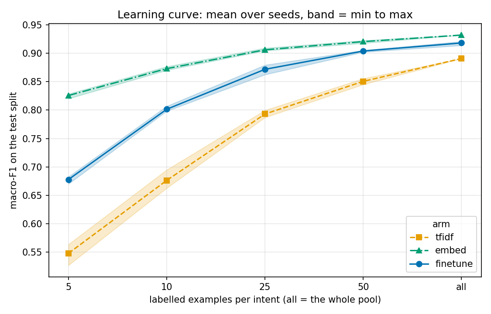

# Results summary

45 runs. Every number below is computed from `runs.csv` and `preds/`.

## Source

Git SHA: `dd2e52afa90004bdbb46bc2e983e9d1724e2d3fa`

## Decision rules (as written in `EVAL_PLAN.md`)

1. **Crossover:** not reached up to k = all
2. **Headline:** fine-tuning did not pay off here; finetune 0.918 vs tfidf 0.891 at k = all: +2.7 points (threshold 5.0)
3. **Null result:** null result: finetune mean <= embed mean at every k (do not fine-tune below the largest k here)

### Rule 1 detail: finetune vs the better baseline at each k

| k | finetune mean (worst seed) | better baseline | its mean (best seed) | mean gap (points) | ranges separate | qualifies |
|---|---|---|---|---|---|---|
| 5 | 0.678 (0.670) | embed | 0.826 (0.829) | -14.8 | no | no |
| 10 | 0.802 (0.798) | embed | 0.873 (0.877) | -7.2 | no | no |
| 25 | 0.872 (0.862) | embed | 0.906 (0.909) | -3.4 | no | no |
| 50 | 0.904 (0.902) | embed | 0.921 (0.923) | -1.7 | no | no |
| all | 0.918 (0.914) | embed | 0.932 (0.932) | -1.4 | no | no |

### Rule 3 detail: finetune vs embed at each k

| k | finetune mean | embed mean | gap (points) | finetune <= embed |
|---|---|---|---|---|
| 5 | 0.678 | 0.826 | -14.8 | yes |
| 10 | 0.802 | 0.873 | -7.2 | yes |
| 25 | 0.872 | 0.906 | -3.4 | yes |
| 50 | 0.904 | 0.921 | -1.7 | yes |
| all | 0.918 | 0.932 | -1.4 | yes |

## Macro-F1, mean [min, max] over seeds

| arm | k=5 | k=10 | k=25 | k=50 | k=all |
|---|---|---|---|---|---|
| tfidf | 0.548 [0.527, 0.564] | 0.676 [0.663, 0.695] | 0.793 [0.787, 0.800] | 0.851 [0.845, 0.856] | 0.891 [0.891, 0.891] |
| embed | 0.826 [0.820, 0.829] | 0.873 [0.870, 0.877] | 0.906 [0.905, 0.909] | 0.921 [0.918, 0.923] | 0.932 [0.932, 0.932] |
| finetune | 0.678 [0.670, 0.683] | 0.802 [0.798, 0.807] | 0.872 [0.862, 0.879] | 0.904 [0.902, 0.905] | 0.918 [0.914, 0.921] |

## Accuracy, mean [min, max] over seeds

| arm | k=5 | k=10 | k=25 | k=50 | k=all |
|---|---|---|---|---|---|
| tfidf | 0.550 [0.531, 0.564] | 0.678 [0.664, 0.697] | 0.794 [0.789, 0.801] | 0.850 [0.845, 0.855] | 0.891 [0.891, 0.891] |
| embed | 0.827 [0.821, 0.830] | 0.873 [0.870, 0.877] | 0.906 [0.905, 0.909] | 0.921 [0.918, 0.923] | 0.932 [0.932, 0.932] |
| finetune | 0.684 [0.674, 0.692] | 0.802 [0.799, 0.807] | 0.872 [0.864, 0.879] | 0.904 [0.902, 0.905] | 0.918 [0.914, 0.921] |

## Expected calibration error, mean [min, max] over seeds

| arm | k=5 | k=10 | k=25 | k=50 | k=all |
|---|---|---|---|---|---|
| tfidf | 0.227 [0.216, 0.236] | 0.213 [0.202, 0.230] | 0.205 [0.130, 0.343] | 0.147 [0.084, 0.268] | 0.039 [0.039, 0.039] |
| embed | 0.309 [0.203, 0.516] | 0.127 [0.125, 0.131] | 0.063 [0.062, 0.064] | 0.130 [0.033, 0.178] | 0.110 [0.110, 0.110] |
| finetune | 0.180 [0.170, 0.196] | 0.031 [0.017, 0.051] | 0.038 [0.019, 0.073] | 0.061 [0.060, 0.062] | 0.036 [0.022, 0.049] |

## Training set size (rows) and seeds per k

| k per intent | tfidf | embed | finetune | seeds (min-max over arms) |
|---|---|---|---|---|
| 5 | 385 | 385 | 385 | 3-3 |
| 10 | 770 | 770 | 770 | 3-3 |
| 25 | 1,925 | 1,925 | 1,925 | 3-3 |
| 50 | 3,805 | 3,805 | 3,805 | 3-3 |
| all | 9,233 | 9,233 | 9,233 | 3-3 |

## Full-data intervals and worst intents (k = all)

Paired bootstrap, 2,000 resamples of the test rows (seed 0), macro over 77 labels, 95% percentile interval: macro-F1(finetune) minus macro-F1(embed), the better baseline at k = all. Same run seed for both arms.

| run seed | baseline | difference (points) | 95% interval (points) | excludes 0 |
|---|---|---|---|---|
| 1 | embed | -1.1 | [-2.1, -0.2] | yes |
| 2 | embed | -1.8 | [-2.8, -0.9] | yes |
| 3 | embed | -1.2 | [-2.1, -0.4] | yes |

### Worst 10 intents by F1, finetune, k = all, seed 1

| rank | intent | F1 | test rows |
|---|---|---|---|
| 1 | transfer_not_received_by_recipient | 0.708 | 40 |
| 2 | pending_transfer | 0.789 | 40 |
| 3 | transfer_timing | 0.810 | 40 |
| 4 | balance_not_updated_after_bank_transfer | 0.817 | 40 |
| 5 | topping_up_by_card | 0.827 | 40 |
| 6 | declined_transfer | 0.829 | 40 |
| 7 | compromised_card | 0.829 | 40 |
| 8 | why_verify_identity | 0.853 | 40 |
| 9 | verify_my_identity | 0.864 | 40 |
| 10 | lost_or_stolen_card | 0.865 | 40 |

### Worst 10 intents by F1, embed, k = all, seed 1

| rank | intent | F1 | test rows |
|---|---|---|---|
| 1 | balance_not_updated_after_bank_transfer | 0.765 | 40 |
| 2 | pending_transfer | 0.783 | 40 |
| 3 | beneficiary_not_allowed | 0.825 | 40 |
| 4 | transfer_not_received_by_recipient | 0.840 | 40 |
| 5 | topping_up_by_card | 0.850 | 40 |
| 6 | transfer_timing | 0.851 | 40 |
| 7 | card_payment_not_recognised | 0.854 | 40 |
| 8 | reverted_card_payment? | 0.854 | 40 |
| 9 | direct_debit_payment_not_recognised | 0.868 | 40 |
| 10 | declined_card_payment | 0.881 | 40 |

